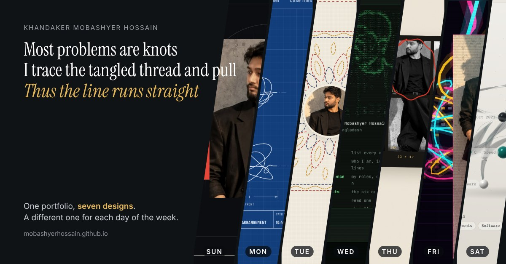

# Khandaker Mobashyer Hossain · Portfolio

> Most problems are knots
> I trace the tangled thread and pull
> Thus the line runs straight

**Live site:** [mobashyerhossain.github.io](https://mobashyerhossain.github.io/) · **All seven designs:** [mobashyerhossain.github.io/?day=week](https://mobashyerhossain.github.io/?day=week)



A personal portfolio for an Assistant Engineering Manager in payments and POS at ADN Technologies Ltd., Dhaka. It is built around one idea: problems are knots, and the work is finding the thread and pulling it straight. Instead of a list of skills, it tells a career arc (developer → senior → lead → head of department → product and partner management) and seven case files, each with the problem, the options, the call made and the result.

The same content is presented in **a different design for each day of the week**. Visitors see the design for their own weekday and can switch to any other.

---

## The seven designs

| Day | Design | Idea | Link |
|---|---|---|---|
| Sunday | **Untangle** | An editorial engineering journal: numbered sections, a timeline, and case files whose knots pull straight | [?day=sun](https://mobashyerhossain.github.io/?day=sun) |
| Monday | **The Blueprint** | An engineering drawing: the knot in four views, case files as drawing sheets, skills as modules on a bus | [?day=mon](https://mobashyerhossain.github.io/?day=mon) |
| Tuesday | **Nakshi Kantha** | A Bengali kantha quilt sewn in running stitch as you read | [?day=tue](https://mobashyerhossain.github.io/?day=tue) |
| Wednesday | **The Terminal** | A command line: type or tap commands; the ASCII portrait decrypts into the photo | [?day=wed](https://mobashyerhossain.github.io/?day=wed) |
| Thursday | **The Archive** | A catalogued collection of records, folders and documents | [?day=thu](https://mobashyerhossain.github.io/?day=thu) |
| Friday | **Cyberpunk Dhaka** | Neon Dhaka at night in 3D, with cables that pull straight | [?day=fri](https://mobashyerhossain.github.io/?day=fri) |
| Saturday | **Living Systems** | A 3D sculpture where every node is part of the work | [?day=sat](https://mobashyerhossain.github.io/?day=sat) |

`?day=` accepts short names (`sun` … `sat`), full day names, or `week` for the overview.

<!-- Added by Mobashyer D-18-11-26: Week 02 -->
## Week 02: seven more designs

A second collection, with the same content and case files, in seven new designs. A **Week 01 / Week 02** selector on the day switcher moves between the collections and keeps the day you're on.

| Day | Design | Idea | Link |
|---|---|---|---|
| Sunday | **Swiss Modernism** | The International Typographic Style: a strict 12-column grid, big type, one red; a kinetic poster whose scattered parts settle into a mark as you scroll | [?week=2&day=sun](https://mobashyerhossain.github.io/?week=2&day=sun) |
| Monday | **The Editorial** | A long-form magazine: a cover, a contents page, and each case file as a feature article that opens full-page, with page turns between features | [?week=2&day=mon](https://mobashyerhossain.github.io/?week=2&day=mon) |
| Tuesday | **Retro Future** | A retro-future console in amber: turn the tuning dial until the tangled signal on the oscilloscope runs straight; modules with switches, a mission log, memory banks | [?week=2&day=tue](https://mobashyerhossain.github.io/?week=2&day=tue) |
| Wednesday | **Glass Architecture** | Layered glass panes over an architectural plan; the career is a glass tower in 3D, four floors high, that you can turn and explore floor by floor | [?week=2&day=wed](https://mobashyerhossain.github.io/?week=2&day=wed) |
| Thursday | **Industrial** | Concrete, steel and safety orange: case files as work orders on a production line; scrolling runs the belt and each order is stamped at the press | [?week=2&day=thu](https://mobashyerhossain.github.io/?week=2&day=thu) |
| Friday | **Neo Minimalism** | Warm, quiet and spare: one reading column, one accent, case files that unfold, and a single thread in the margin whose knots loosen as you read | [?week=2&day=fri](https://mobashyerhossain.github.io/?week=2&day=fri) |
| Saturday | **Data Canvas** | The career as data: the whole portfolio as a 3D network you can turn and explore, an interactive timeline, case files as a network and as architecture flows, skills measured | [?week=2&day=sat](https://mobashyerhossain.github.io/?week=2&day=sat) |

Addresses: `?week=2&day=mon` opens a Week 02 design, `?week=2` opens today's Week 02 design, and `?week=2&day=week` shows all seven. Every address without `week=2` behaves exactly as before, and Week 01 stays the default. All variations share one canonical URL, so search engines see a single page.

## Features

- **Day-based design** chosen from the visitor’s own clock, with a switcher to preview any other day, and a Week 01 / Week 02 selector for the second collection. Switching happens without a reload, with a thread-pulling transition, and the browser’s Back and Forward buttons work.
- **Week view** showing every design side by side: screenshots appear instantly, then each live page loads behind its card.
- **Consistent menu** on every design: Career, Case files, What’s next, Skills, Education, Apps and Contact, in page order. On narrow screens it scrolls sideways instead of hiding links.
- **A tab icon for each day**, which changes as soon as you switch.
- **Shared content**: every design reads the same facts, so they never disagree.
- **Date-aware wording**: forward-looking text (for example the December 2026 role change) switches to the present automatically on its date.
- **Share and print**: copy a link to the design you’re viewing, or print a clean three-page summary from any design.
- **Payment apps in use**: short terminal walkthroughs of bank payment applications, shown with the banks’ permission. They play muted, only while on screen.
- **Education, research and certifications** in their own sections; certificates open in a view-only dialog.
- **Accessible**: keyboard operable throughout, respects reduced-motion settings, and works without JavaScript (a plain, readable version of the full content is in the page itself).
- **Search-ready**: one canonical URL, Open Graph and X card tags, JSON-LD structured data (ProfilePage, Person, VideoObject), sitemap and robots.txt.
- **No build step on GitHub, no frameworks**: plain HTML, CSS and JavaScript. Three.js (loaded only on the 3D days, and on Week 02 only when the 3D part nears the screen) is the only library.

## Repository contents

```
index.html                 the whole site: all fourteen designs, shared content and runtime
404.html                   custom “page not found” page
robots.txt                 crawler rules
sitemap.xml                sitemap with image and video entries
og.jpg                     link-preview image for LinkedIn, Facebook and X
mobashyer-hossain.jpg      portrait used by search engines and the plain version
cv.pdf                     public CV (no phone number)
certificates/              certificate images (.webp), shown in the viewer only
media/                     payment app walkthrough videos (.mp4) and their posters (.jpg)
media/week/                screenshots shown instantly in the week view (w2-*.webp for Week 02)
```

## How it works

`index.html` is generated as a single file. It contains:

1. **A plain, semantic version of the whole portfolio**: what search engines and visitors without JavaScript read.
2. **The shared content** as JSON, in `<script type="application/json" id="kmh-content">`.
3. **Fourteen design templates** (seven per collection), one block each, using simple `{{placeholder}}` tags that are filled from the shared content.
4. **A small runtime** that picks the day, fills the chosen template with the content, writes it into the page, and handles switching, the week view, sharing, printing and the certificate viewer.

Each design is self-contained: its own fonts, styles and scripts, which are cleaned up when you switch to another day.

### Editing content

Quick text changes can be made directly in the JSON block inside `index.html`; every design picks them up. The plain no-JavaScript version, the structured data and the sitemap are generated from the same content by the build script, so a full rebuild keeps them in step.

## Running it locally

The week view loads the site inside frames, which browsers block for files opened straight from disk, so serve the folder over HTTP:

```bash
python3 -m http.server 8000
# then open http://localhost:8000/
```

## Deployment

GitHub Pages, from the `main` branch, root folder. Push the files above and the site updates within a minute or two. After changing `og.jpg` or the page title, re-scrape the link preview in the [LinkedIn Post Inspector](https://www.linkedin.com/post-inspector/) and the [Facebook Sharing Debugger](https://developers.facebook.com/tools/debug/).

## Content, privacy and permissions

- Client names appear only where there is permission to show them; elsewhere clients are described by type.
- The payment app videos are published with the respective banks’ permission.
- No phone number is published on the site or in the public CV.

## Credits

- [Three.js](https://threejs.org/) (MIT licence), loaded from cdnjs for the two 3D designs.
- Typefaces from [Google Fonts](https://fonts.google.com/) (SIL Open Font Licence).
- Designed and built with AI assistance ([Claude](https://claude.ai/)).

## Licence

© 2026 Khandaker Mobashyer Hossain. All rights reserved. The text, photographs, videos, certificates and designs in this repository may not be reused without permission.

## Contact

- Email: [hossain.mobashyer007@gmail.com](mailto:hossain.mobashyer007@gmail.com)
- LinkedIn: [linkedin.com/in/mobashyer-hossain](https://linkedin.com/in/mobashyer-hossain)
- GitHub: [github.com/MobashyerHossain](https://github.com/MobashyerHossain)
